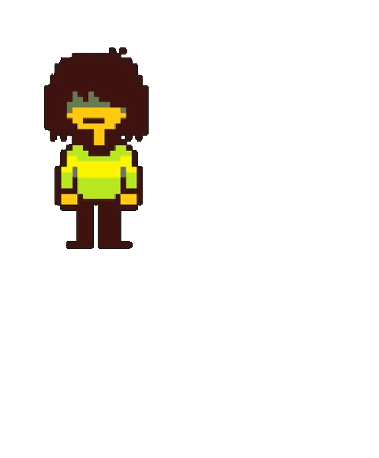
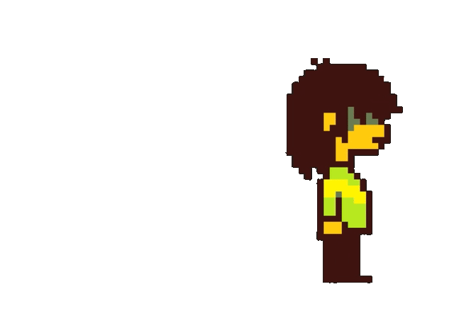
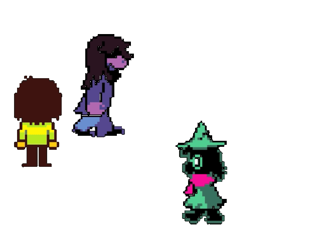

  <h1 id="english">MyDeltabuddies</h1>

MyDeltabuddies is a desktop pet extension for Visual Studio Code. Just open it, sit back (or code, as you mostly will), and watch your favorite characters roam around and interact with each other.

## Features

- **Autonomous characters**: A lively, animated panel right at your VS Code sidebar! The characters walk freely throught the panel and idle when they want!

  
  

- **Don't escape from your screen**: If any of your characters reach the border, it bounces for the opposite direction!

  
  

- **Multicharacters and Animations**: Watch Kris, Susie and Ralsei roam arround and do stuff!

  
  

## Usage

> To be done in release branch

## ⚠️ Legal Notice

This project is a **FREE** fan-made extension for personal use.
The [**Deltarune**](https://deltarune.com/) characters, sprites, and related assets are the intellectual
property of [**Toby Fox**](https://x.com/tobyfox) and are not covered by this project's license.

If you are the rights holder and wish for these assets to be removed,
please contact me and I will do so immediately.