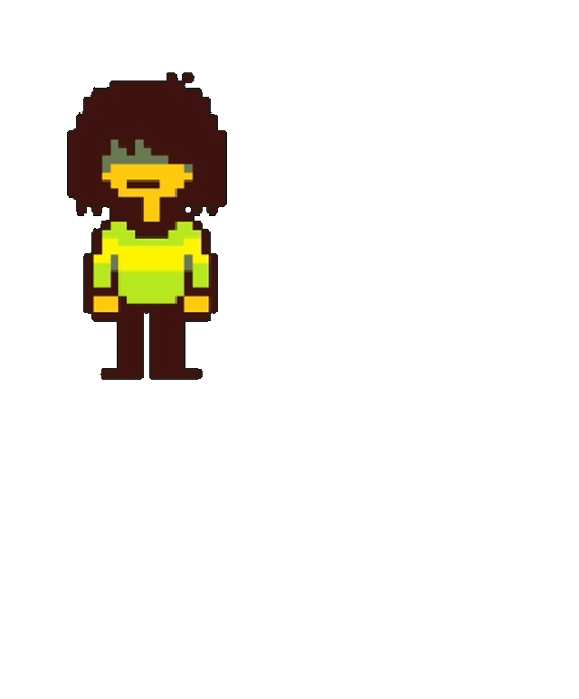
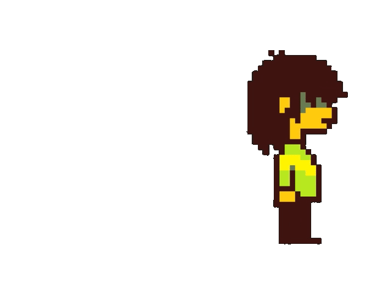
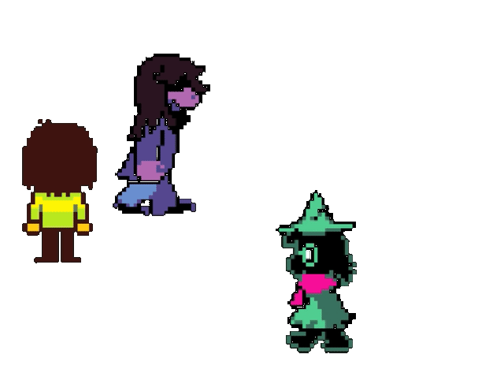

<div align="center">
  
  
  
  
  
  

</div>

[**Em Português**](#portugues)

<div align="center">
  <h1 id="english">MyDeltabuddies</h1>
</div>

MyDeltabuddies is a desktop pet extension for Visual Studio Code. Just open it, sit back (or code, as you mostly will), and watch your favorite characters roam around and interact with each other.

## Features

- **Autonomous characters**: A lively, animated panel right at your VS Code sidebar! The characters walk freely throught the panel and idle when they want!

<div align="center">
  
  

</div>

- **Don't escape from your screen**: If any of your characters reach the border, it bounces for the opposite direction!

<div align="center">
  
  

</div>

- **Multicharacters and Animations**: Watch Kris, Susie and Ralsei roam arround and do stuff!

<div align="center">
  
  

</div>

## Requirements

This extension is **not yet published** on the VS Code Marketplace. To test it locally, you'll need:

- **Node.js** (v18 or higher) -> https://nodejs.org/
- **npm** (comes with Node.js)

## Running the extension locally

1. Clone the repository:
   ```bash
   git clone https://github.com/trelosoke/my-deltabuddies.git
   cd my-deltabuddies
   ```
2. Install dependencies:
   ```bash
   npm install
   ```

3. Compile the extension:
   ```bash
   npm run compile
   ```

4. Open the project in VS Code and **press F5** to launch a new window with the extension loaded.

The extention is now running, enjoy!

## Project Structure

```
mydeltabuddies/
├── src/                      # Extension host (TypeScript)
│   ├── extension.ts
│   └── features/
│       ├── helpers/
│       └── providers/
├── media/                    # Aquarium rendered in the webview (JavaScript)
│   ├── main.js               # Bootstrap
│   ├── animation.js          # Game loop
│   ├── character.js          # State machine, animation and rendering
│   ├── characterManager.js   # Character collection and Y-sorted drawing
│   ├── movement.js           # Movement and boundary bounce
│   ├── charactersConfig.js   # Character data
│   ├── validateConfig.js     # Config validation at startup
│   └── sprites/              # Sprite sheets
├── tests/                    # Unit tests (node:test)
├── docs/                     # Architecture notes and demo gifs
└── ...
```
   

## ⚠️ Legal Notice

This project is a **FREE** fan-made extension for personal use.
The [**Deltarune**](https://deltarune.com/) characters, sprites, and related assets are the intellectual
property of [**Toby Fox**](https://x.com/tobyfox) and are not covered by this project's license.

If you are the rights holder and wish for these assets to be removed,
please contact me and I will do so immediately.

---

<div align="center">
  <h1 id="portugues">MyDeltabuddies</h1>
</div>

MyDeltabuddies é uma extensão pet de desktop para Visual Studio Code. Apenas abra, sente-se (ou code, como você normalmente irá), e assista seus personagens favoritos andarem por aí e interagirem uns com os outros.

## Funcionalidades

- **Personagens autônomos**: Um painel vivo e animado diretamente na barra lateral do seu VS Code! Os personagens andam livremente por ele e ficam parados quando querem!

<div align="center">
  
  

</div>

- **Não escapam da tela**: Se qualquer um dos seus personagens chegar na borda da tela, eles "quicam" para a direção oposta!

<div align="center">
  
  

</div>


- **Múltiplos personagens e Animações**: Veja Kris, Susie e Ralsei andarem por aí e fazerem várias coisas!

<div align="center">
  
  

</div>

## Requisitos

Essa extensão ainda **não foi publicada** no Marketplace do VS Code. Para testá-la localmente, você precisará de:

- **Node.js** (v18 ou maior) -> https://nodejs.org/
- **npm** (vem com o Node.js)

## Rodando a extensão localmente

1. Clone o repositório:
   ```bash
   git clone https://github.com/trelosoke/my-deltabuddies.git
   cd my-deltabuddies
   ```
2. Instale as dependências:
   ```bash
   npm install
   ```

3. Compile a extensão:
   ```bash
   npm run compile
   ```

4. Abra o projeto no VS Code e **aperte F5** para abrir uma nova janela com a extensão carregada.

A extensão agora está rodando, aproveite!

## Estrutura do projeto

```
mydeltabuddies/
├── src/                      # Host da extensão (TypeScript)
│   ├── extension.ts
│   └── features/
│       ├── helpers/
│       └── providers/
├── media/                    # Aquário renderizado na webview (JavaScript)
│   ├── main.js               # Bootstrap
│   ├── animation.js          # Game loop
│   ├── character.js          # Máquina de estados, animação e renderização
│   ├── characterManager.js   # Coleção de personagens e desenho ordenado por Y
│   ├── movement.js           # Movimento e quique nas bordas
│   ├── charactersConfig.js   # Dados dos personagens
│   ├── validateConfig.js     # Validação da config no boot
│   └── sprites/              # Sprite sheets
├── tests/                    # Testes unitários (node:test)
├── docs/                     # Notas de arquitetura e gifs de demo
└── ...
```
   

## ⚠️ Aviso legal

Esse projeto é uma extensão fan-mande **GRATUITA** e para uso pessoal.
Os personagens, sprites e assets relacionados de [**Deltarune**](https://deltarune.com/) são propriedade intelectual de [**Toby Fox**](https://x.com/tobyfox) e não são abrangidas pela licença desse projeto.

Se você é o dono dos direitos e deseja que esses assets sejam removidos, por favor me contate e eu o farei imediatamente quando possível.